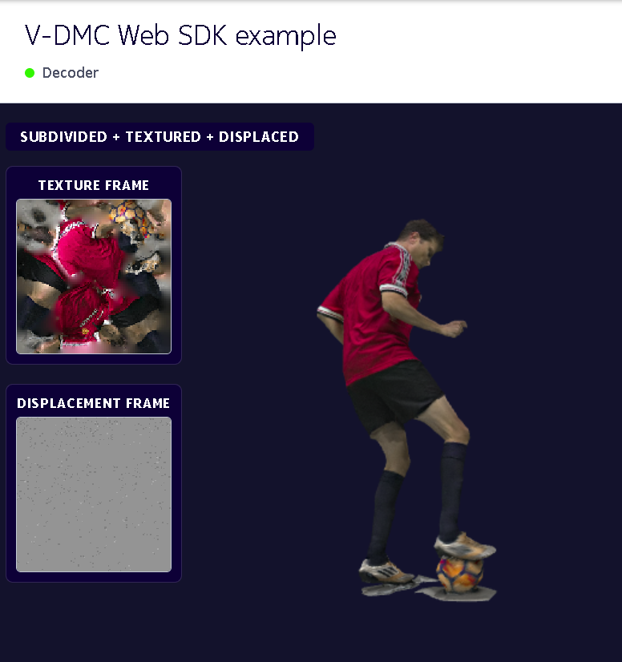

<p align="center">
  
</p>

<p align="center">
  Decodes MPEG V-DMC (ISO/IEC 23090-29) bitstreams and plays the animated, textured, displaced mesh in the browser with WebAssembly, WebCodecs and WebGL2.
</p>

<p align="center">
  
  <a href="https://github.com/5G-MAG/rt-vdmc-web-decoder-player/releases"></a>
  <a href="LICENSE"></a>
</p>

<p align="center">
  <a href="https://www.5g-mag.com/reference-tools/vdmc/">Project page</a> &nbsp;&middot;&nbsp;
  <a href="https://github.com/5G-MAG/rt-vdmc-web-decoder-player/issues">Issues</a> &nbsp;&middot;&nbsp;
  <a href="https://www.5g-mag.com/contributing">Contributing</a>
</p>

---

## At a glance

|  |  |
|---|---|
| **Implements** | ISO/IEC 23090-29:2026, Edition 1 — Video-based dynamic mesh coding (V-DMC) |
| **Part of** | [Dynamic Mesh Coding with MPEG V-DMC](https://www.5g-mag.com/reference-tools/vdmc/) |

## Introduction

V-DMC compresses an animated 3D mesh into a low-resolution base mesh plus displacement and
texture video streams. This repository decodes a V-DMC (`.vmesh`) bitstream entirely in the
browser and renders the animated, textured, displaced mesh in real time with WebGL2 / Three.js.
Where rt-v3c-unity-player and rt-v3c-decoder-plugin target Windows and Android through Unity,
the web target runs on any device with a Chromium-based browser, with no installation.
Encoding is out of scope: streams are produced with the MPEG reference encoder.

Decoding is split across three layers:

| Layer | Runs in | Responsibility |
|-------|---------|----------------|
| **WASM base-mesh decoder** | Web Worker | Parse the `.vmesh` container; decode the base mesh + displacement metadata per frame |
| **WebCodecs HEVC decoder** | Main thread | Decode the texture and displacement video sub-streams to raw frames |
| **GPU subdivision + displacement** | WebGL2 shader | Subdivide each base triangle, apply per-vertex displacement, texture & light |



| Path | Contents |
|------|----------|
| [`sdk/`](sdk/) | The runtime SDK — `src/` modules, the prebuilt WASM decoder in `wasm/`, and the bundled builds in `dist/`. Embed this in your app. See [`sdk/README.md`](sdk/README.md). |
| [`sample-app/`](sample-app/) | A minimal Three.js viewer that plays a bundled `.vmesh` clip. |
| [`verification/`](verification/) | A headless encode → decode → compare test validating the SDK against the reference decoder. See [`verification/README.md`](verification/README.md). |
| [`verify/`](verify/) | An interactive desktop + mobile test that captures the SDK's GPU shader output and compares it per-vertex against the reference decoder. See [`verify/README.md`](verify/README.md). |
| [`docs/`](docs/) | Architecture, build, V-DMC feature set and displacement-calibration documentation. |
| [`tm-reference/`](tm-reference/) | Ships only `wasm_decoder.patch` — the decoder-only changes applied to the reference software. The verification tests additionally expect the natively built `bin/` and the reference `cfg/` to be placed here locally (git-ignored). |
| `serve.py` | Dev server that sets the required cross-origin-isolation headers. |
| `NOTICE` | Project copyright notice + third-party notices (BSD-3-Clause WASM decoder, MIT Three.js, patent notice). |

## Specification

Built against ISO/IEC 23090-29:2026, Edition 1. The WASM decoder is compiled from the MPEG
reference software (test model TMM v17.0) by applying a single patch — the reference sources
themselves are **not** redistributed here (see [License](#license)).

> **Bitstream compatibility:** TMM v17.0 changed the atlas (ASPS) extension syntax and the
> base-mesh codec numbering, so `.vmesh` streams encoded with TMM v16.0 or earlier do not decode.
> Re-encode them with the TMM v17.0 encoder.

Clause-by-clause coverage, and what is still absent, is recorded on the project page rather than
here: <https://www.5g-mag.com/reference-tools/vdmc>. The coding tools this project exercises are
listed in [`docs/VDMC-FEATURES.md`](docs/VDMC-FEATURES.md).

## Install dependencies

Running the decoder needs only Python 3 (for the dev server) and a Chromium-based browser with
WebCodecs HEVC support. The SDK ships a prebuilt WASM decoder, so no toolchain is needed to use it.

Rebuilding the WASM decoder additionally needs git, the Emscripten SDK (3.1.x or newer),
CMake (3.20 or newer) and Ninja; rebuilding the SDK bundles needs Node.js:

```bash
# Emscripten: https://emscripten.org/docs/getting_started/downloads.html
source /path/to/emsdk/emsdk_env.sh
```

## Downloading

```bash
cd ~
git clone https://github.com/5G-MAG/rt-vdmc-web-decoder-player.git
```

## Building

The WASM decoder is built by applying
[`tm-reference/wasm_decoder.patch`](tm-reference/wasm_decoder.patch) to a clean TMM v17.0
checkout of the MPEG reference software and compiling the `decode` target with Emscripten:

```bash
FOSS=$PWD                       # this repository
TM=/scratch/mpeg-vmesh-tm       # a checkout kept outside this repository

# clone the official reference software and apply the decoder patch
git clone --single-branch -b v17.0 \
  https://git.mpeg.expert/MPEG/3dgh/v-dmc/software/mpeg-vmesh-tm.git "$TM"
git -C "$TM" apply "$FOSS/tm-reference/wasm_decoder.patch"

# build with Emscripten
cd "$TM"
emcmake cmake -S . -B build_wasm -DCMAKE_BUILD_TYPE=Release \
  -DMESH_TYPE=float -DCMAKE_POLICY_VERSION_MINIMUM=3.5
cmake --build build_wasm --target decode
```

The SDK bundles in `sdk/dist/` are rebuilt with `npm install && npm run build && npm run build:standalone`
in [`sdk/`](sdk/). Full details, prerequisites and troubleshooting: [`docs/BUILD-WASM.md`](docs/BUILD-WASM.md).

## Installing

Copy the freshly built decoder into the SDK. Copy **both** files together — they must come from
the same build:

```bash
cp build_wasm/source/app/decode.js   "$FOSS/sdk/wasm/vdmc_decode.js"
cp build_wasm/source/app/decode.wasm "$FOSS/sdk/wasm/decode.wasm"
```

To use the SDK in your own app, add a `VDMCMesh` to a Three.js scene:

```html
<script type="importmap">
{ "imports": {
    "three": "https://cdn.jsdelivr.net/npm/three@0.160.0/build/three.module.js",
    "three/addons/": "https://cdn.jsdelivr.net/npm/three@0.160.0/examples/jsm/"
} }
</script>
<script type="module">
  import * as THREE from 'three';
  import { VDMCMesh } from '/sdk/src/VDMCMesh.js';

  // THREE.Group subclass — add it to your scene and drive it like a media element
  const vdmc = new VDMCMesh({ src: '/path/to/stream.vmesh', renderer, autoPlay: true, loop: true });
  scene.add(vdmc);

  // in your render loop
  vdmc.update(performance.now());
</script>
```

`VDMCMesh` is the recommended entry point; `VDMCMeshStream` (decode only) and
`VDMCPlayer` (playback only) are available for finer control. For deployment, prefer the
prebuilt bundles in [`sdk/dist/`](sdk/dist/) — `sdk/dist/vdmc_decoder.standalone.js` is a
single file with Three.js, the decoder worker and the WASM binary all inlined, so it needs no
import map at all. See [`sdk/README.md`](sdk/README.md) for the full API.

## Running

The page must be **cross-origin isolated** (COOP + COEP) for the Worker + WASM + WebCodecs
path; `serve.py` sets those headers:

```bash
python serve.py                 # serves on http://localhost:8080 (port is the optional first argument)
# open http://localhost:8080/sample-app/index.html
```

## Configuration

The player is configured in code through the `VDMCMesh` constructor; the main options and their
defaults are `autoPlay = true`, `loop = true`, `fps = 30`, `subdivLevel = 3`, `dispScale = 1.0`,
`wireframe = false` and `ringSize = 8` (see [`sdk/README.md`](sdk/README.md#vdmcmesh)).
The hosting page must be served with `Cross-Origin-Opener-Policy: same-origin` and
`Cross-Origin-Embedder-Policy: require-corp`, as `serve.py` does.

The verification tests read two environment variables: `VDMC_EDGE_EXE` (path of the
Chromium-based browser to drive) and `VDMC_INPUT_DIR` (directory of the source mesh frames).

## Development

Contributions are made from a fork on a feature branch and merged into `development` through a
pull request.

Three test suites validate the SDK against the native MPEG reference decoder:

| Suite | What it checks | Run |
|-------|----------------|-----|
| [`verification/`](verification/README.md) | Native encode → decode, then the SDK's GPU output compared per vertex with the reference (intra, inter, or the bundled sphere) | `node run-verification.mjs [--sphere] [--inter --count 4]` |
| [`verification/parity/`](verification/parity/README.md) | `SubdivideMesh.js` displacement indexing and reconstruction on two bundled datasets (sphere, football) | open `verification/parity/test.html?data=sphere` |
| [`verify/`](verify/README.md) | The SDK's shader output on desktop and mobile GPUs against the reference decoder | open `verify/test.html?dump` |

The native reference tools are not part of this repository; build them from the same TMM v17.0
checkout and place them under `tm-reference/bin/` (see [`verification/README.md`](verification/README.md#requirements)).

Further documentation:

- [`docs/ARCHITECTURE.md`](docs/ARCHITECTURE.md) — system architecture, data flow, and the C++ ⇄ JS boundary.
- [`docs/VDMC-FEATURES.md`](docs/VDMC-FEATURES.md) — which V-DMC coding tools are used, and every encoder setting that deviates from the reference defaults.
- [`docs/BUILD-WASM.md`](docs/BUILD-WASM.md) — building the WASM decoder from the reference software.
- [`docs/DISPLACEMENT-CALIBRATION.md`](docs/DISPLACEMENT-CALIBRATION.md) — how 10-bit displacement is recovered bit-exactly over WebCodecs.

## Contributing

Contributions are welcome. How to raise an issue, fork the repository and open a pull request, and
the Contributor License Agreement required before code can be merged, are described at
<https://www.5g-mag.com/contributing>.

## License

Distributed under the 5G-MAG Public License v1.0. See [LICENSE](LICENSE).

Copyright 2026 Nokia. The project copyright notice and all third-party notices are in [NOTICE](NOTICE).
`tm-reference/wasm_decoder.patch` is a derivative diff against the MPEG V-DMC reference
software, which ISO/IEC distributes under the BSD 3-Clause licence and which is obtained
separately from the MPEG git server; the prebuilt `sdk/wasm/decode.wasm` and its glue are
compiled derivatives of it, and `sdk/dist/vdmc_decoder.standalone.js` additionally embeds
Three.js (MIT). See [`docs/ARCHITECTURE.md`](docs/ARCHITECTURE.md#4-licensing-aspects) for the
full breakdown, including the patent caveat for V-DMC and HEVC.
