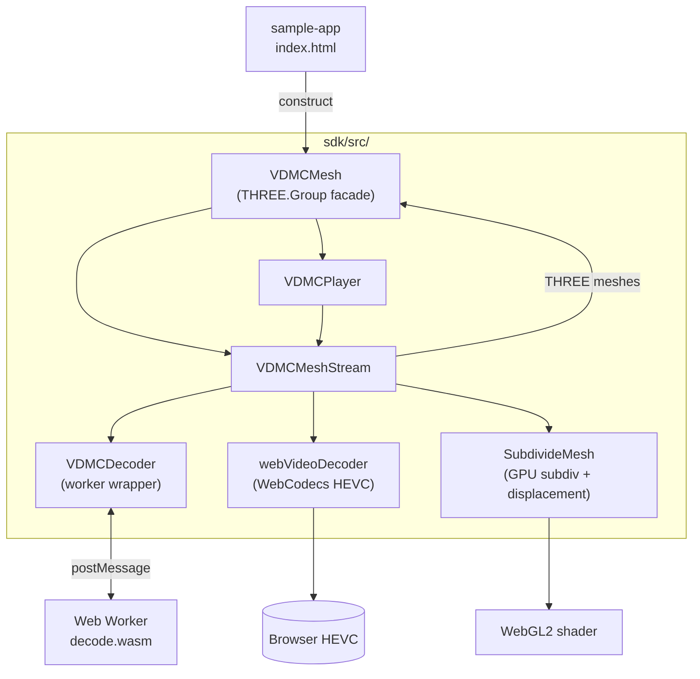
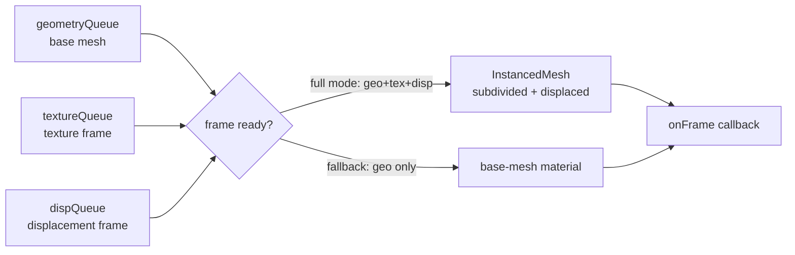
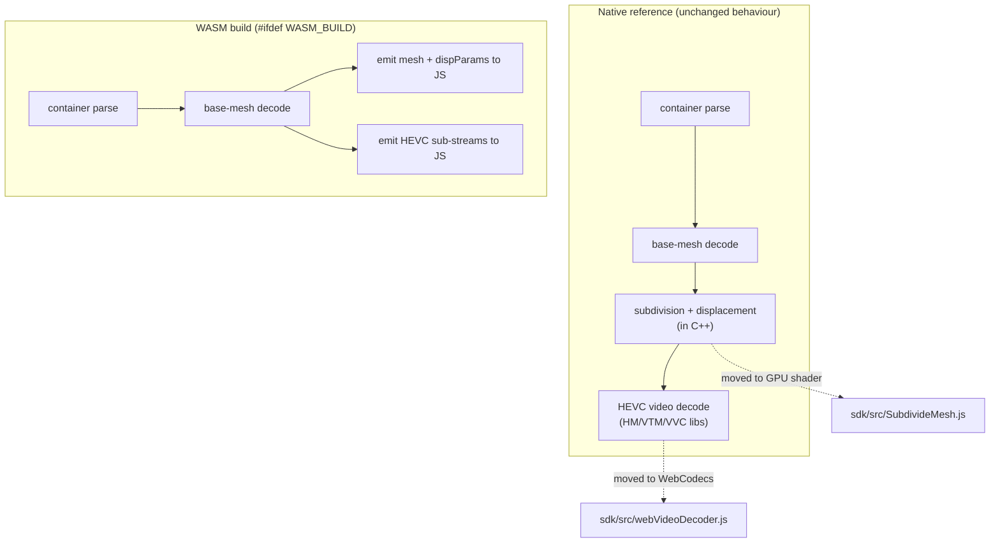
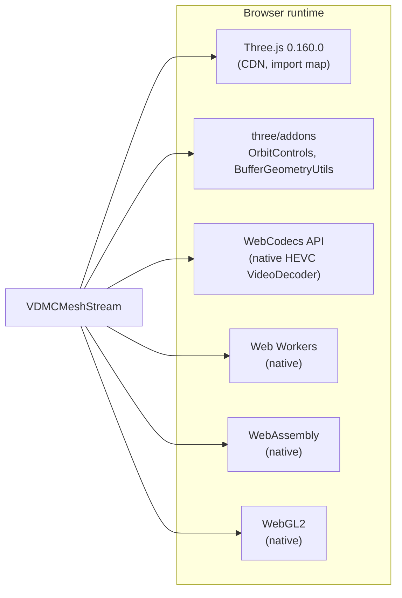
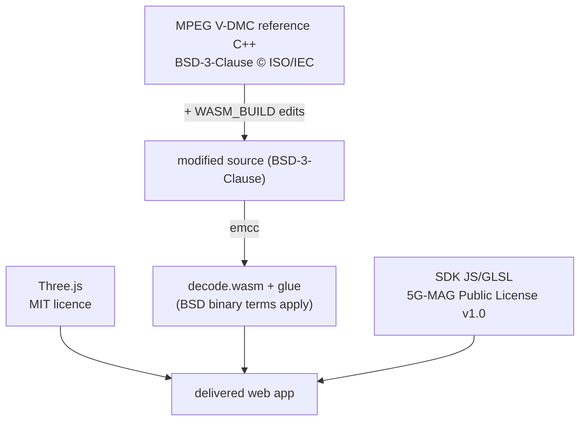

# V-DMC Web Decoder — Architecture

This document covers:

1. [Overall architecture and data flow](#1-overall-architecture-and-data-flow)
2. [Scope of modifications to the MPEG V-DMC reference software](#2-scope-of-modifications-to-the-mpeg-v-dmc-reference-software)
3. [Handling of dependencies (Three.js, WebCodecs, …)](#3-handling-of-dependencies)
4. [Licensing aspects, including the WASM decoder](#4-licensing-aspects)

---

## 1. Overall architecture and data flow

The decoder is split into three cooperating layers that run in different browser contexts.
The C++ reference decoder is compiled to WebAssembly but **only** parses the container and
reconstructs the base mesh; subdivision, displacement and video decoding are delegated to
the browser's GPU and WebCodecs.

### Component overview

### The "3-queue" model

For each `frameId` the stream collects three independent inputs and emits the final mesh
only when the required ones are present:

| Render mode | Trigger | Result |
|-------------|---------|--------|
| `full` | WebCodecs HEVC supported | subdivided + textured + displaced |
| `basemesh` | HEVC unavailable / decode error | untextured base mesh only |

---

## 2. Scope of modifications to the MPEG V-DMC reference software

The reference software is used **as-is** for the native build. Existing files are modified only
behind `#ifdef WASM_BUILD` (or `#ifndef`), so they compile out of the native path; the few new
files the patch adds are pulled in only by the Emscripten CMake configuration. The web build
also moves the **video** and **subdivision/displacement** stages out of C++ entirely.

### Files touched (all `WASM_BUILD`-guarded)

| Area | File(s) | Modification |
|------|---------|--------------|
| Decoder boundary | `source/lib/vmeshDecoder/decoder.cpp`, `decoderOAuvcoord.cpp` | Emit base mesh + displacement metadata to JS callbacks (`onBaseMesh`, `onDispParams`); pass video sub-streams to JS rather than subdividing/displacing/decoding video in C++. |
| Decoder app | `source/app/decode.cpp` | Expose the decode entry point to the Emscripten module instead of a native `main()`-only flow. |
| Web video decoder | `source/wrapper/videoDecoder/webVideoDecoder{,Impl}.{cpp,hpp}` (new), `videoDecoder.{cpp,hpp}` | Route video sub-streams to the JS/WebCodecs decoder instead of HM/VTM/VVC. |
| Atlas / base-mesh decode | `source/lib/atlasDecoder/atlasDecoder.cpp`, `source/lib/basemeshDecoder/baseMeshDecoder.cpp`, `source/lib/basemeshBitstream/baseMeshCommon.hpp` | Guards for the decoder-only WASM target. |
| Web stubs | `source/lib/vmeshCommon/wasm_stubs.cpp` (new) | Replacements for native-only functions. |
| Mesh / image / misc I/O | `source/lib/vmeshCommon/util/{mesh,image,vector,vector_patch}.{hpp,cpp}`, `vmc.hpp`, `vmcCommon.cpp` | WASM buffer accessors; skip native file and image I/O. |
| Options parser | `dependencies/program-options-lite/program_options_lite.h` | Drop `exceptions(failbit)` under WASM. |
| Build config | `CMakeLists.txt`, `source/app/CMakeLists.txt`, `source/lib/{vmeshCommon,basemeshDecoder}/CMakeLists.txt`, `source/wrapper/videoDecoder/CMakeLists.txt` | Emscripten toolchain, codec toggles, link flags. |

> Net effect: the **bitstream parsing and base-mesh reconstruction** remain the reference
> implementation; only the *output boundary* (callbacks instead of file writes) and the
> *post-processing stages* (subdivision, displacement, video) are relocated to the web
> platform. See [`BUILD-WASM.md`](./BUILD-WASM.md) for details.

---

## 3. Handling of dependencies

### Native (build-time) dependencies

These are required only to **build** the reference software / encoder natively and to
produce test content. They are **excluded from the WASM build** via CMake guards and never
ship to the browser:

| Dependency | Purpose | In WASM build? |
|------------|---------|----------------|
| HM / VTM / VVC (`vvenc`/`vvdec`) | Native HEVC/VVC video codecs | ❌ off — replaced by WebCodecs |
| Draco | Geometry codec | ❌ off |
| DirectX-Headers/Math/Mesh, UVAtlas | UV atlas / mesh tooling | ❌ off |
| mmetric, tinyply, nanoflann | Metrics / mesh I/O | ❌ off |
| CPM / CMake tooling | Dependency fetching | build-time only |

### Runtime (browser) dependencies

The shipped SDK is intentionally light. The only third-party runtime dependency is
**Three.js** (+ its add-ons), loaded from a CDN via an import map; everything else is a
browser-native Web API.

Notes:

- **Three.js** is consumed via the standard `"three"` / `"three/addons/"` import-map
  specifiers, so an app can swap the CDN for a self-hosted/bundled copy without touching the
  SDK. The SDK imports the symbols it needs directly and sets no globals, so it never
  interferes with an application's own Three.js instance.
- **`dist/vdmc_decoder.standalone.js` is the exception**: it inlines Three.js and
  `OrbitControls` for hosts that cannot supply them (offline WebViews, no import map). It
  re-exports that bundled instance as `THREE` / `OrbitControls`, and the host **must** use
  those re-exports — importing Three.js separately alongside it loads two independent copies
  into the page. Prefer `dist/vdmc_decoder.js` wherever an import map is available.
- **A-Frame** is *not* a dependency of this SDK. Because the renderer produces standard
  Three.js `Object3D`/`InstancedMesh` objects, it can be embedded inside an A-Frame/WebXR
  scene by an application if desired, but A-Frame is not pulled in by the SDK itself.
- **WebCodecs, Web Workers, WebAssembly, WebGL2** are all native browser capabilities — no
  third-party libraries. WebCodecs HEVC support is feature-detected with graceful fallback.
- **Cross-origin isolation** (`COOP`/`COEP`) is required by the host page for the
  Worker + WASM + WebCodecs combination.

---

## 4. Licensing aspects

### This project's code and the reference software

The SDK, sample app, verification tests and this documentation are Copyright 2026 Nokia and
licensed under the **5G-MAG Public License (v1.0)** — full text in
[`../LICENSE`](../LICENSE), notices in [`../NOTICE`](../NOTICE).

The MPEG V-DMC reference software is distributed by **ISO/IEC** under the **BSD 3-Clause
licence** (see the `COPYING` file in the reference software checkout). It is **not**
redistributed here — `tm-reference/` ships only `wasm_decoder.patch`, the decoder-only diff
against TMM17 v17.0:

> Copyright (c) 2022, ISO/IEC — All rights reserved. … *This software may be subject to other
> third party and contributor rights, including patent rights, and no such rights are granted
> under this licence.*

The WASM-specific modifications (Section 2) are edits to that BSD-licensed source and inherit
the same terms.

### The compiled WASM decoder

`sdk/wasm/decode.wasm` is produced by compiling the BSD-licensed reference C++ with
Emscripten. As a derived binary of BSD-3-Clause source, the licence's binary-redistribution
clause applies: **reproduce the copyright notice and disclaimer** in accompanying
documentation when distributing the `.wasm`/glue.

### Important caveats

> ⚠️ **Patents.** The BSD licence explicitly grants **no patent rights**. V-DMC and HEVC are
> covered by standards-essential patents. Decoding HEVC in the browser relies on the
> platform's own licensed WebCodecs implementation; shipping a V-DMC/HEVC product may require
> separate patent licensing independent of this software licence.

| Component | Licence | Redistribution requirement |
|-----------|---------|----------------------------|
| Reference C++ (obtained separately from MPEG) | BSD-3-Clause © ISO/IEC | Retain notice + disclaimer |
| Decoder patch (`tm-reference/wasm_decoder.patch`) | BSD-3-Clause (derivative diff) | Retain notice + disclaimer |
| WASM decoder (`sdk/wasm/`) | BSD-3-Clause (compiled derivative) | Reproduce notice in docs |
| SDK JS/GLSL (`sdk/src/`) | 5G-MAG Public License v1.0 | Retain notice |
| Three.js (external, via import map) | MIT | Retain MIT notice if self-hosted |
| Three.js (inlined in `dist/vdmc_decoder.standalone.js`) | MIT | Notice reproduced in the bundle's banner + trailing `@license` block |
| WebCodecs / WebGL2 / WASM | Browser-native APIs | None (platform-provided) |
| HEVC bitstream decoding | Standards-essential patents | Platform-licensed; product may need separate patent licence |

---

### See also

- [`../sdk/README.md`](../sdk/README.md) — SDK usage and the `VDMCMesh` / `VDMCMeshStream` / `VDMCPlayer` API.
- [`BUILD-WASM.md`](./BUILD-WASM.md) — rebuilding the WASM decoder.
- [`VDMC-FEATURES.md`](./VDMC-FEATURES.md) — the V-DMC coding tools this pipeline exercises.
- [`../verification/README.md`](../verification/README.md) — headless encode → decode → compare test.
- [`../verify/README.md`](../verify/README.md) — interactive desktop + mobile GPU reconstruction check.
