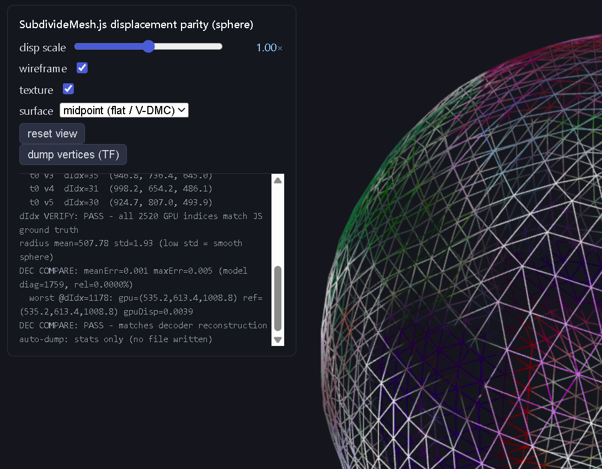
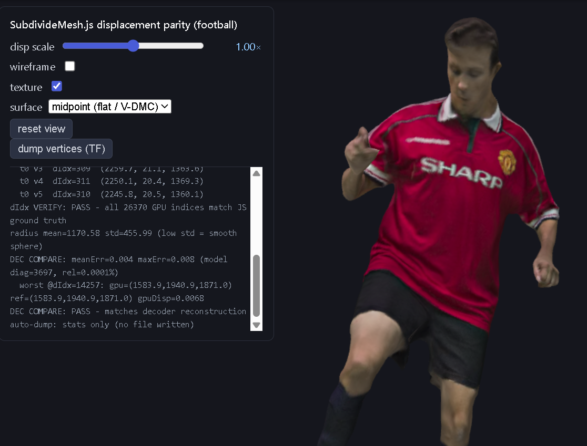

# Displacement parity test

One browser test page that checks [`sdk/src/SubdivideMesh.js`](../../sdk/src/SubdivideMesh.js) reproduces
the reference decoder's reconstruction exactly, against interchangeable datasets.

It answers two questions independently:

1. **dIdx numbering** — does the GPU shader assign each subdivided vertex the same global
   displacement index the decoder does? Checked against a JS ground truth, per vertex.
2. **Reconstruction** — do the displaced GPU positions equal the decoder's reconstructed mesh?
   Checked per displacement index against `dec.obj`.

Unlike [`../../verify/`](../../verify/), this test does **not** run the SDK's decode path. It
feeds a native reference displacement YUV straight into the production shader, which isolates the
subdivision/displacement math from the WebCodecs video path.

## Tools

### `test.html` — the test page

Loads a dataset, builds the base geometry exactly as
[`VDMCMeshStream._buildBaseGeometry`](../../sdk/src/VDMCMeshStream.js) does, synthesizes the
`dispParams` object the decoder would emit, and calls the production `SubdivideMesh()`. It then
captures the shader's output through the shared
[`../gpu-capture.mjs`](../gpu-capture.mjs) — the same module `verify/` and `run-verification.mjs`
use — so all three tests measure the same thing through the same code.

Shared modules it depends on:

| Module | Used for |
|--------|----------|
| [`/sdk/src/SubdivideMesh.js`](../../sdk/src/SubdivideMesh.js) | the subject under test — GPU subdivision + displacement |
| [`/sdk/src/subdivNumbering.mjs`](../../sdk/src/subdivNumbering.mjs) | `cumulativeCounts`, `buildCanonicalDescriptors`, `flattenRecipe`, `evalOps` — the CPU ground truth every captured `dIdx` is compared against |
| [`/verification/gpu-capture.mjs`](../gpu-capture.mjs) | the shared shader-output capture (transform feedback, or RGBA8 readback with `?rtt`) |
| [`../../serve.py`](../../serve.py) | cross-origin-isolation headers, and the `/log` endpoint console output is mirrored to |

The base-edge table (`ebm`) is rebuilt in-page by a port of the decoder's `initializeSubdiv`
numbering, because a standalone dataset has no decoder to supply one. Use `?decedge` to substitute
the decoder's own `edgeTable` from `params.json` and diff the two.

### `prep.mjs` — dataset assembler

Turns a kept verification run into a dataset:

```powershell
node run-verification.mjs --keep              # or: --sphere --keep
node parity/prep.mjs --data <name> [<run reference dir>]
```

It reads `<run>/reference/` — `base_sdk.obj` (or `fr_0_base_dec.ply`),
`disp_dec_<W>x<H>_10bits_p420.yuv`, `decoded_0000.obj`, `dispParams.json`, plus the decoded texture
and `browser_disp.json` when present — and writes `data/<name>/` in the standard layout below.
Without a run directory it picks the newest `runs/test.<stamp>/reference` that has a
`dispParams.json`. Defaults to `--data sphere`.

> ⚠️ `--data <name>` only names the **output** dataset; it does not select the input run. If the
> newest run is a different asset, you will silently overwrite `data/<name>/` with that asset's
> data — self-consistent, so it still passes, but no longer the asset its name claims. Always
> pass the run directory explicitly when several runs exist, and check the `ready from test.<stamp>`
> line prep.mjs prints.

## Dataset layout

Every dataset is `data/<name>/` with the same file names, so the test has no per-asset
special cases:

| File | Contents |
|------|----------|
| `params.json` | `subdiv`, `dispWidth`, `dispHeight`, `log2BlockSize`, `geomBitDepth`, `refScale`, `packingMethod`, `edgeTable`, `hasTex` — the values the SDK receives via `onDispParams` |
| `base.obj` | base mesh in canonical (decoder) vertex order — must not be reordered |
| `disp.yuv` | native reference displacement, Y plane, 10-bit LE |
| `dec.obj` | decoder's reconstructed mesh; vertices are in global `dIdx` order (ground truth) |
| `tex.png` | colour texture (optional, `hasTex`) |
| `browser_disp.json` | the browser's WebCodecs-decoded displacement, for `?browserdisp` (optional) |

Bundled datasets:

| Name | Origin | Status |
|------|--------|--------|
| `sphere` | our encode of the clean sphere asset (`run-verification.mjs --sphere --keep`) | dIdx PASS, reconstruction PASS (rel 0.0000%) |
| `football` | our encode of the football sequence | dIdx PASS, reconstruction PASS (rel 0.0001%) |

| `sphere` | `football` |
|----------|------------|
|  |  |

Both carry a decoder `edgeTable` in `params.json`. A dataset without one makes the test fall
back to its own edge numbering, which `dIdx VERIFY` cannot validate — it would compare the GPU
against a JS ground truth built from the same recomputed table, so a numbering that is
self-consistent but different from the decoder's still reports PASS while the reconstruction
drifts. Always generate datasets with `prep.mjs` so the decoder's table is included.

## Run

```powershell
python serve.py 8097
# open http://localhost:8097/verification/parity/test.html?data=sphere
```

### Query parameters

| Parameter | Effect |
|-----------|--------|
| `?data=<name>` | dataset under `data/` (default `sphere`) |
| `?dump` | run the transform-feedback capture and comparison automatically on load |
| `?decedge` | use the decoder's `edgeTable` from `params.json` instead of the recomputed one |
| `?browserdisp` | build the displacement texture from `browser_disp.json` instead of the native YUV — isolates whether the browser's decoded *values* cause the error |
| `?rtt` | force the shared capture's RGBA8 readback path instead of transform feedback |
| `?bits=8` | requantize the displacement to 8 bits, emulating an 8-bit canvas snapshot |
| `?range=tv` | treat the luma as limited/studio range 10-bit (`[64,940]`) instead of full range |

Without `?dump` the page is interactive: displacement scale slider, wireframe, texture toggle,
midpoint vs PN surface, and a **dump vertices (TF)** button that also downloads the captured
point cloud as OBJ.
